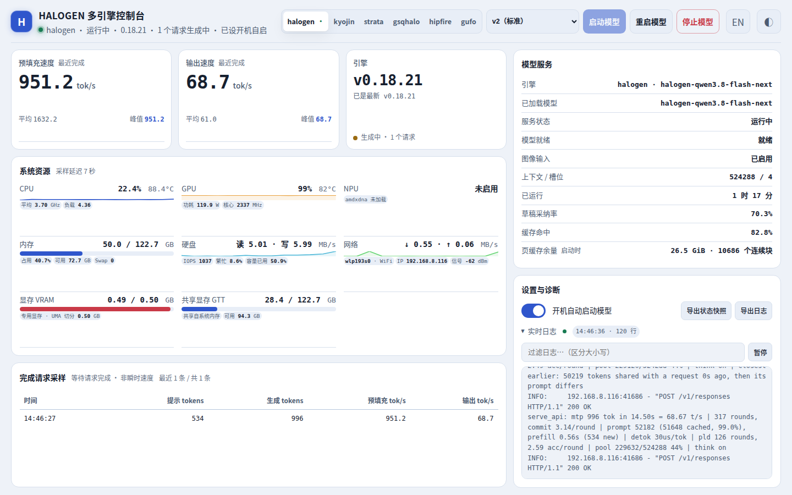

# HALOGEN Console

A zero-build web control panel (port **8733**) for a multi-engine local LLM host: start / stop / restart mutually exclusive inference engines from any device on your LAN, and watch live engine + system metrics while they run.

Built for an AMD Ryzen AI Max (Strix Halo, 128 GB) box where each engine needs most of the machine's memory — so only one engine can run at a time, and the panel *enforces* that exclusivity instead of just documenting it.



[中文](#中文) · [English](#english)

---

## English

### What it is

Two files, no build step, one dependency:

| File | Role |
|---|---|
| `halogen-control.py` | aiohttp backend — serves the page and a small JSON API |
| `halogen-control.html` | the entire frontend (markup + CSS + JS in one file) |
| `halogen-control.service` | systemd **user** unit to run it |

The backend never launches engines by hand-crafted commands: it drives **systemd user units** only, so "how an engine starts" is defined in exactly one place. System state (CPU, memory, GPU VRAM, NPU) is read from `/proc` and `/sys` — no external tools.

### Managed engines

The engine registry (`ENGINES` in the .py) is the single source of truth. This machine's registry:

| Engine | Unit | Endpoint | Notes |
|---|---|---|---|
| `halogen` | `halogen-docker` | `:8731` `/health` `/metrics` | runs in Docker; logs via `docker logs` |
| `kyojin` | `kyojin-qwen` | `:8731` `/v1/models` `/slots` `/stats` | Qwen3.8-Flash-Next (EXL3); the GLM lane was retired 2026-10-22 |
| `strata` | `strata` | `:8731` `/health` `/v1/status` | no cumulative counters → panel keeps its own rate accumulator |
| `gsqhalo` | `gsqhalo` | `:8731` `/health` `/slots` `/props` `/metrics` | rootless podman container |
| `hipfire` | `hipfire-27b` | `:8731` `/health` `/stats` `/metrics` | native Rust/HIP engine; Qwen3.8-27B MQ4 XTS + DFlash + vision, single slot at 262144 ctx (`--max-seq 262144`, `--vision` + `HIPFIRE_VISION_MODE=on`) |
| `gufo` | `gufo` | `:8731` `/health` `/slots` `/props` `/metrics` | gufo-org/gufo (Strix-Halo-specific C++/HIP engine) in a rootless podman container; Qwen3.8-Flash-Next UD-Q4_K_XL + MTP + vision, 2 sessions at 262144 ctx |

All six engines bind **8731**; only one runs at a time (enforced by the panel), so port reuse is a consequence of the mutual exclusion, not a conflict.

### Key behaviors

- **Mutual exclusion enforced**: `start`/`restart` of one engine first stops the others (and any other variant of the same engine). `restart` is *stop → wait for memory to actually be returned → start*, because a dying llama.cpp engine takes seconds-to-tens-of-seconds to release ~105 GB of GTT and naive restarts die on memory gates.
- **Halogen checkpoint switcher**: pick which `.hgn` checkpoint the halogen unit loads (`HALOGEN_CHECKPOINT=` line). Switching atomically rewrites the unit file (with rolling backup + timestamped comment), runs `daemon-reload`, and always `reset-failed`s the unit first so rapid switches don't trip systemd's `StartLimitBurst`.
- **Metrics auto-detection**: all engines bind 8731 (mutually exclusive); the panel selects the active engine from systemd unit state and asks only that engine's endpoint (halogen `/metrics`, kyojin `/stats`, strata `/v1/status`, gsqhalo `/metrics`, hipfire `/metrics`, gufo `/metrics`), so probe 404s never pollute another engine's log. It renders prefill/decode rates, KV usage, MTP draft acceptance, and a rate history table; strata has no cumulative counters, so the panel accumulates its own history from completed requests. hipfire's `/metrics` provides request/prompt/completion counters and per-request prefill/decode histograms; the panel uses counter deltas for the sample table and histogram sums for averages. **Peaks are the maximum actual sampled per-request value since panel start** (no histogram bucket bounds; reset on panel restart). For hipfire the draft cell shows cumulative mean accepted length τ (`spec_tau`) rather than an acceptance percentage, and the headroom cell shows the startup `free_after_weights` (labelled "free after weights") instead of halogen's contiguous-block page-cache metric.
- **NPU row**: amdxdna utilization is derived by differencing the driver's per-client `fdinfo` engine counters; when the NPU is held by a root process inside the halogen container, a persistent `docker exec` stream reads it from inside the container.
- **Upstream update checks**: halogen compares `/health` version vs GitHub tags (numeric-tuple compare — string compare ranks `0.9.0` above `0.14.0`); source-built engines compare the local git HEAD against upstream via the GitHub compare API (5-min cache); hipfire compares its checkout's exact tag against `warpfront/hipfire` release tags (non-version tags such as `safety/win_*` are filtered); gufo compares `/props.build_info` against `gufo-org/gufo` tags.
- **Log viewer**: reads `docker logs` / `journalctl` / `podman logs` per engine, filters the panel's own probe noise (`/health`, `/metrics`, `/stats`, `/cache`), with raw and export variants.
- **Bilingual UI (zh/en)**: static text via `data-i18n` tags, dynamic text via an `I18N` dict; switching re-renders from in-memory state so you never see a half-translated screen. Server-side error strings follow the `X-Lang` header. Choice persists in `localStorage`.
- **CSRF guard without auth**: the LAN is trusted (no password), but every POST must carry `Content-Type: application/json`. That makes it a non-simple request, so a cross-site `fetch` would trigger a CORS preflight — which this service never answers — and thus a random webpage cannot stop your model.
- **Engine API auth passthrough**: if the halogen engine runs with `HALOGEN_API_KEY`, the panel reads the same key file and attaches `Authorization: Bearer …` to every local engine request (all engines get the header; only halogen checks it). Requests to external hosts (GitHub) always use their own headers, so the key never leaves the machine. If the key file is absent the header is simply omitted and everything works as before.

### Quick start

```bash
# 1. Python 3 + aiohttp (the only dependency)
python3 -c "import aiohttp" || sudo apt install python3-aiohttp

# 2. Put the files where you want them and adapt the constants at the top of
#    halogen-control.py to YOUR machine: LISTEN_HOST/LISTEN_PORT, DOCKER/PODMAN
#    paths, and the ENGINES registry (units, URLs, source dirs).

# 3. Install the systemd user unit (edit ExecStart to your path first)
mkdir -p ~/.config/systemd/user
cp halogen-control.service ~/.config/systemd/user/
systemctl --user daemon-reload && systemctl --user start halogen-control.service

# 4. Open http://<host>:8733
```

The HTML is re-read whenever its mtime changes (edit the page → just refresh). Editing the `.py` needs `systemctl --user restart halogen-control.service`.

### HTTP API

| Route | Method | Purpose |
|---|---|---|
| `/` | GET | the console page |
| `/api/status` | GET | engine state, checkpoint/variant, unit states, system resources |
| `/api/quick` | GET | auto-detected engine metrics (rates, KV, draft acceptance) |
| `/api/update` | GET | upstream version/commit check (cached 300 s) |
| `/api/logs` | GET | engine logs (probe noise filtered; `?all=1` for raw) |
| `/api/export/status`, `/api/export/logs` | GET | plain-text exports |
| `/api/action` | POST | `start` / `stop` / `restart` (+ `engine`, `variant`, `checkpoint`) |
| `/api/boot` | POST | enable/disable autostart (also mutually exclusive) |

All engine-scoped routes accept `?engine=` (plus `&variant=` where an engine defines model variants); POSTs may also put these in the JSON body.

### Notes

- The registry, ports, and paths are hardcoded for one specific machine. The *pattern* (single-file panel driving systemd units for mutually exclusive engines) is the reusable part — adapt `ENGINES` to yours.
- No authentication: intended for a trusted LAN. The Content-Type guard above limits damage from browsers, not from `curl`.

---

## 中文

为"一台机器、多个大模型推理引擎、同一时刻只能跑一个"的本地主机（AMD Strix Halo 128 GB）写的零构建网页控制台。两个文件（aiohttp 后端 + 单文件前端）、一个依赖（aiohttp），通过 systemd 用户单元统一驱动各引擎，局域网内任意设备都能启停模型并查看实时指标。

- **引擎登记表**是唯一事实来源：halogen（Docker，8731）、kyojin（Qwen 单车道，8731；GLM 车道 2026-10-22 回收）、strata（8731）、gsqhalo（podman，8731）、hipfire（原生 Rust/HIP，8731；Qwen3.8-27B MQ4 XTS + DFlash + 视觉）、gufo（rootless podman 容器，8731；Qwen3.8-Flash-Next UD-Q4_K_XL + MTP + 视觉）。
- **互斥由面板强制实现**：启动/重启任一引擎会先停掉其余引擎；"重启"是 停止 → 等内存真正归还 → 启动，而不是 `systemctl restart`（大模型退出后 GTT 归还需要几十秒，直接重启会撞上内存门槛）。开机自启同样互斥。
- **halogen 检查点切换**：改单元文件里 `HALOGEN_CHECKPOINT=` 一行（原子写 + 滚动备份 + daemon-reload），启动前无条件 `reset-failed` 防 systemd 启动频率限制误伤。
- **指标自动识别**：按 systemd 活动单元判别当前在跑的引擎，只问该引擎自己的端点（halogen `/metrics`、kyojin `/stats`、strata `/v1/status`、gsqhalo `/metrics`、hipfire `/metrics`、gufo `/metrics`），探测 404 不会污染别的引擎日志；展示预填充/解码速率、KV 占用、MTP 草稿采纳率与速率历史；strata 无累计计数器，由面板自行按完成的请求累计。
- **NPU 状态行**：对 amdxdna 驱动 fdinfo 引擎计数器两次采样求差；NPU 被容器内 root 进程占用时经一条常驻 `docker exec` 流在容器内读取。
- **上游更新检查**：halogen 对比 GitHub tag（数值元组比较）；源码构建的引擎用 compare API 对比本地 HEAD 与上游（缓存 300 s）。
- **日志查看**：按引擎读 `docker logs` / `journalctl` / `podman logs`，过滤面板自身的探测噪声，支持原始视图与导出。
- **中英双语界面**：静态文案 `data-i18n` + 动态文案 `I18N` 字典，切换语言从内存状态整体重渲染；服务端错误文案跟随 `X-Lang` 请求头；选择存 `localStorage`。
- **无口令但有 CSRF 防护**：所有 POST 要求 `Content-Type: application/json`（非简单请求 → 跨站 fetch 必触发 CORS 预检，而本服务不返回 CORS 头），别的网页无法诱导浏览器停掉模型。
- **跟随引擎 API 鉴权**：halogen 开 `HALOGEN_API_KEY` 时，面板读同一份密钥文件，对本机引擎的所有请求统一带 `Authorization: Bearer …`（六个引擎都带，只有 halogen 校验）；对外部主机（GitHub）的请求始终用自己的头，密钥不出机器。密钥文件不存在就省略该头，一切照旧。
- **前端热更新**：HTML 按 mtime 缓存，改完刷新即生效；改 `.py` 需 `systemctl --user restart halogen-control.service`。

快速开始见上文 [Quick start](#quick-start)。

## License

[MIT](LICENSE)
